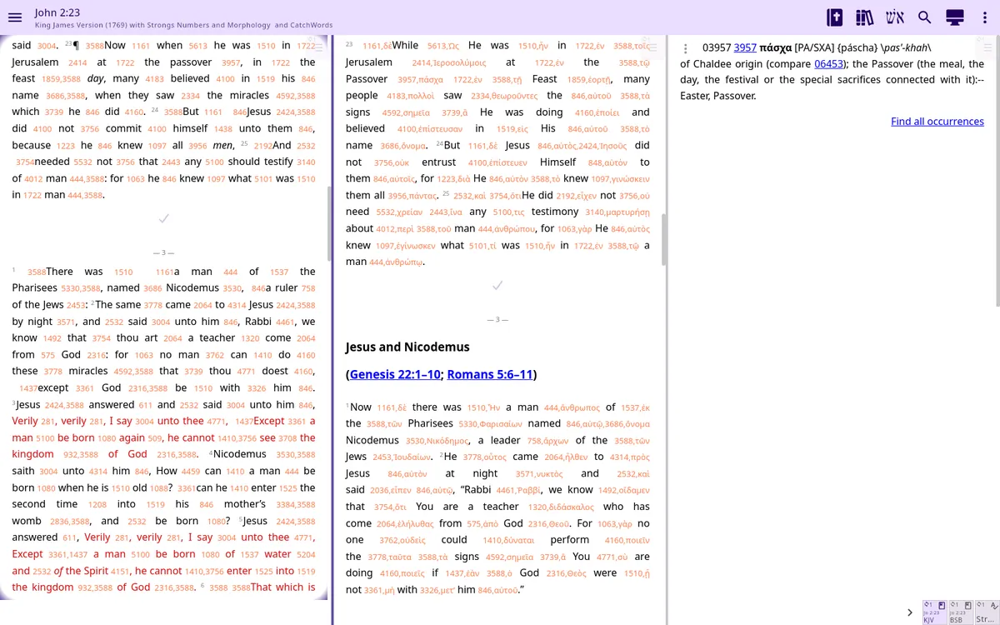

# AndBible on Windows and Linux

<!-- if beta -->
!!! note "Public beta"
    AndBible for Windows and Linux is new in AndBible 6.0, which is in public beta. Please
    [report the problems you find](#reporting-a-bug).

AndBible runs on Windows and Linux as well as on Android, iPhone, iPad and Mac. It is the same app; see [Platform differences](platform_differences.md) for what differs. Download the Windows MSI and the Linux `.deb` and AppImage of the beta from the newest *Beta release* on the [GitHub releases page]({{ beta_release }}) only. For step-by-step installation see [Getting started](getting_started.md).
<!-- else -->
AndBible runs on Windows and Linux as well as on Android, iPhone, iPad and Mac. It is the same app; see [Platform differences](platform_differences.md) for what differs. Download the Windows MSI and the Linux `.deb` and AppImage from [GitHub Releases](https://github.com/AndBible/and-bible/releases/latest) only. For step-by-step installation see [Getting started](getting_started.md).
<!-- end -->



On a Mac there is no separate desktop build. Install the iPad app from the [App Store](https://apps.apple.com/us/app/andbible-bible-study/id6774904527) on an Apple Silicon Mac; Intel Macs are not supported.
<!-- if testflight -->
The 6.0 beta for Mac is the iPad app's [TestFlight beta]({{ testflight }}).
<!-- end -->
<!-- if beta -->
<!-- if not testflight -->
The 6.0 beta for iPhone, iPad and Mac is coming soon through TestFlight; until then the App Store has the current version.
<!-- end -->
<!-- end -->

## Windows reading engine

On Windows x64, AndBible uses the system **Microsoft Edge WebView2 Evergreen Runtime** for document text. Windows normally keeps this runtime up to date independently of AndBible. The MSI includes the small WebView2 loader, not a bundled Chromium browser.

If WebView2 is missing or cannot start, AndBible shows an error with the [WebView2 Runtime download link](https://developer.microsoft.com/microsoft-edge/webview2/) and the log file location, then closes. Install or repair the Evergreen Runtime and try again. The app does not download a browser at startup.

The reading view requires the Direct3D graphics renderer. If the window uses a different renderer, AndBible shows a graphics-specific error instead of an empty reading window. Remove any forced software/OpenGL renderer override and check your graphics driver; installing WebView2 alone does not solve a graphics-renderer error. Diagnostic details are logged in `%APPDATA%\AndBible\logs\andbible.log` and included in bug reports.

Switching workspaces reuses the reading pages. Returning to a workspace restores its StudyPad, Bible and commentary panes without restarting the browser page.

## Linux packages

The regular `andbible` `.deb` includes Chromium (KCEF). It remains the default Linux package, and the AppImage also uses Chromium.

The optional `andbible-webkitgtk` `.deb` uses the system's **WebKitGTK 6.0 (GTK4)** instead. It does not include Chromium's native libraries, so the download is smaller and WebKit security updates come from your Linux distribution. It requires Linux x86-64 and a distribution that provides `libwebkitgtk-6.0-4`; install the `.deb` with your package manager so that dependency is installed too. This variant needs X11, or Xwayland in a Wayland desktop session. It is not published with the current releases while it is being improved; it can be built from source with `./gradlew :desktopWebkitGtk:packageDeb`.

The two `.deb` packages have separate launchers but share the same AndBible data and settings. Only one can use that data at a time. The WebKitGTK variant is an alternative; keep the regular Chromium package available if you encounter rendering or input problems.

## Display scaling on Linux

AndBible follows your desktop's display scale: the menus, toolbars and the Bible text get the same size as in other apps. It reads the scale that GNOME, KDE Plasma and Xfce publish for X11 apps (the `Xft.dpi` setting, which also includes GNOME's "Large Text" setting), or `GDK_SCALE` when it is set. On Wayland the app runs through Xwayland, so the scale comes from what the desktop gives Xwayland apps.

If the size is still wrong, set it yourself with the `ANDBIBLE_UI_SCALE` environment variable, from `0.5` to `4` (fractions such as `1.25` work, as do `125%` and `120dpi`):

```bash
ANDBIBLE_UI_SCALE=1.5 andbible
```

Good to know:

- The scale is read when the app starts. After changing the desktop's scale or `ANDBIBLE_UI_SCALE`, restart AndBible.
- The WebKitGTK variant rounds a fractional scale to a whole number for the menus and toolbars (125 % shows them at 100 %, 150 % at 200 %); its Bible text still gets the desktop's size. The Chromium variant started with `-Dandbible.kcef.rendering=windowed` rounds the Bible text too.
- On GNOME with fractional scaling where X11 apps are not scaled natively (they look slightly blurry), GNOME enlarges the whole app window itself. There `ANDBIBLE_UI_SCALE` multiplies with GNOME's scale: `1.25` makes the app 25 % larger than other apps.

The chosen scale and where it came from are written at start-up to the log as a line starting with `display scale`: `~/.local/share/andbible/logs`. If no scale was found, the line says why. Please include that line when you report a scaling problem.

## Update checks

Eligible GitHub builds ask whether to check for updates. If you agree, AndBible contacts GitHub at most once a day. GitHub sees your IP address and the app version in the user agent. No cookies or device identifier are sent. You can change your choice using **Check for updates** in Settings. When a newer version is found, AndBible can open its release page; you install it yourself. The update check never offers a release that is less stable than the one you have installed.
<!-- if beta -->

**Offer public beta updates** (also in Settings) decides whether public beta versions are offered. It is on by default when you have a public beta installed and off by default when you have a production release installed. Turn it on in a production install to be offered newer public betas. Turn it off in a beta install to be offered production releases only: you then wait until a production release is newer than your beta, and are never moved to an older version. The setting is not shown for Flatpak, Microsoft Store (MSIX) and development installs, which update through their own channel or not at all, nor for developer test builds, which always see every channel.

<!-- end -->

## If AndBible cannot start

The startup error screen shows the error details and the log folder under your data directory. Choose **Open log folder** to inspect `andbible.log`, or **Report a bug** to prepare a diagnostic report and open your mail application. These actions work even when the app cannot finish starting. If your data directory is not writable, fix its permissions first so a report can be saved.

A module that fails during discovery is logged and skipped so the remaining documents can load. Include `andbible.log` when reporting a document that disappeared after restarting. EPUB documents installed through document sync can be opened after a cold start, just like other installed documents.

## Where your data lives

On Linux, AndBible stores data in `$XDG_DATA_HOME/andbible` (normally `~/.local/share/andbible`), configuration in `$XDG_CONFIG_HOME/andbible` (normally `~/.config/andbible`), and cache in `$XDG_CACHE_HOME/andbible` (normally `~/.cache/andbible`).

On Windows, data is in `%APPDATA%\AndBible`, configuration in its `config` subdirectory, and cache in `%LOCALAPPDATA%\AndBible\cache`. Bible documents are stored in the `sword` directory under the data directory.

## Known limitations {#known-limitations}

- Printing is not available.
- There is no find in the current page. Use the search in the app to search in a Bible instead.
- Your reading position is saved when you close the window. A forced kill (SIGKILL or *End process*) or a power cut can lose changes since the previous save.

See also [Platform differences](platform_differences.md).

## Reporting a bug {#reporting-a-bug}

In the app open the navigation menu, then *Feedback / bug report* (in its *Contact* group). Please tell us your operating system and version, whether you use Wayland or X11 on Linux, and what you were doing when the problem happened.

The app first asks you where to save the report file. A short dialog then always shows what to do next, whether or not an email program can be opened:

- send an email to `errors.andbible@gmail.com` (*Copy address*);
- attach the saved report file, whose full path is shown (*Copy file path*, *Open folder*), because an email link cannot attach files itself;
- use the suggested subject, for example `AndBible 6.0.1255 bug: <short description>` (*Copy subject*), replacing the placeholder with a few words;
- in the message, tell us what you did and what happened.

When you close the dialog, AndBible tries to open your email program with a prepared message that already holds the device and version details. If none opens (common on Linux), use the copied address and subject in any email program. The report file contains only device and version details and the log; what you did and what happened go in your email.
